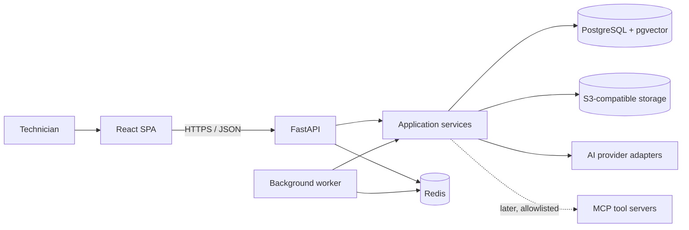
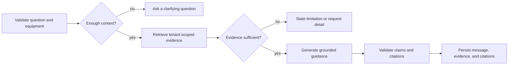

# File2FormAI Architecture

## 1. Purpose and scope

File2FormAI provides evidence-grounded troubleshooting for equipment-intensive organizations. A technician chooses an equipment model or instance, describes a symptom, and receives guidance supported by citations into organization-approved technical documents.

The core is domain-neutral. Organization configuration supplies branding, terminology, equipment taxonomy, models, documents, prompts, AI policies, and allowed tools. Army-specific names, workflows, and assumptions belong in organization configuration or optional domain packages, never in core modules.

### First MVP outcome

Two organizations can independently:

1. configure equipment models and instances;
2. upload and ingest technical manuals;
3. ask an equipment-scoped troubleshooting question; and
4. receive an answer whose citations resolve to the exact document version and page evidence used.

Cross-tenant access must fail at authorization, persistence, retrieval, storage, job, session, event, and client-cache boundaries.

### MVP exclusions

- production OIDC deployment and organization administration workflows;
- external tool execution beyond interface-level foundations;
- voice input/output;
- general workflow builders or multiple agent workflows;
- OCR and rich table/diagram understanding unless needed by the first manual corpus; and
- durable pause/resume of LangGraph execution across processes.

Messages, retrieved evidence, and citations may be retained for traceability in the MVP. “Durable workflows” means checkpointed, resumable execution and remains a later capability.

## 2. Architectural style

File2FormAI is a monorepo containing a modular monolith. The deployable backend may run separate API and worker processes, but both use the same domain modules and database. This keeps transactions and policy enforcement straightforward while leaving module boundaries suitable for later extraction if scale or ownership requires it.



FastAPI is the only application API. Browser clients do not access the database, Redis, AI providers, or tool servers directly. If direct object-storage upload is introduced later, FastAPI must authorize and issue a narrowly scoped upload grant; storage does not become a second application API.

## 3. Target repository structure

This is the intended structure for later scaffolding, not a claim that these directories currently exist.

```text
File2FormAI/
├── apps/
│   └── web/                       # React + Vite + TypeScript SPA
├── backend/
│   ├── src/file2formai/
│   │   ├── api/                   # routes, request context, schemas, dependencies
│   │   ├── core/                  # settings, errors, database/unit-of-work primitives
│   │   ├── identity/              # users, memberships, authn/authz
│   │   ├── organizations/         # organizations and tenant configuration
│   │   ├── equipment/             # models and instances
│   │   ├── documents/             # documents, versions, parsing, ingestion
│   │   ├── retrieval/             # lexical/vector search, RRF, evidence
│   │   ├── troubleshooting/       # sessions, messages, citations, workflow
│   │   ├── agents/                # agent configuration and provider ports
│   │   ├── tools/                 # registry, policy, execution, audit
│   │   └── workers/               # task entry points; no domain rules
│   ├── migrations/                # Alembic migrations
│   └── tests/
├── prompts/                       # reviewed and version-controlled prompts
├── infra/                         # Docker Compose and deployment assets
└── docs/                          # architecture, model, and ADRs
```

The future web application should organize code by feature rather than mirror database tables. Shared UI primitives belong separately from feature state. Every TanStack Query key for tenant data begins with the active `organization_id`, and changing organization clears or invalidates organization-scoped state.

## 4. Backend module boundaries

| Module | Owns | Does not own |
| --- | --- | --- |
| Identity | users, memberships, identity claims, authorized request context | equipment or document policy |
| Organizations | organization lifecycle and settings | global weakening of platform invariants |
| Equipment | equipment models, instances, and applicability | file parsing or answer generation |
| Documents | document metadata, immutable versions, stored objects, parsing and ingestion state | retrieval ranking or response generation |
| Retrieval | lexical/vector search, filtering, reciprocal-rank fusion, evidence snapshots | HTTP concerns or final prose |
| Troubleshooting | sessions, messages, workflow orchestration, answer/citation validation | provider-specific SDK behavior |
| Agents | prompt selection, agent configuration, LLM and embedding ports/adapters | tenant authorization |
| Tools | organization allowlists, registry, execution policy, invocation audit | autonomous bypass of service policy |

HTTP routes validate transport-shaped input, resolve an authorized `RequestContext`, invoke one application service, and translate results into response schemas. Services own use-case rules and transaction boundaries. Repositories own persistence mechanics, not authorization policy; nevertheless, every tenant-owned repository method requires `organization_id` so an unscoped query is difficult to express.

Modules may depend on another module's published service or value-object contract. They must not reach into another module's ORM models or repositories to implement cross-module behavior. Worker entry points and LangGraph nodes are adapters that call the same application services used by HTTP routes.

## 5. Tenant identity and authorization

### Request context

Tenant routes operate on an explicitly resolved active organization. In local development, the organization may be selected with a development-only request header; production organization selection will be derived from authenticated identity and authorized membership. A client-supplied organization value is never authorization proof. Authorization verifies a `Membership` for the selected organization and constructs a request context containing:

- `user_id`;
- active `organization_id`;
- the organization-specific role.

Request/correlation identifiers will be added with the audit and observability foundation.

Services accept this trusted context or an internal job context, never a raw client-supplied tenant ID as proof of access. A user can switch among organizations only through memberships they hold.

OIDC/JWT is the production authentication model. The local development identity adapter must require both a development environment and an explicit enable flag. Startup fails if that adapter is enabled anywhere else. Production authentication is a release gate before any external pilot.

### Defense-in-depth isolation

- Every tenant-owned row carries `organization_id`; same-organization relationships use composite constraints where practical.
- Repositories and services require `organization_id`, and services validate all referenced records in the same context.
- Retrieval applies the tenant predicate inside both full-text and vector queries before ranking or limiting.
- Object keys begin with an opaque organization namespace and are issued only after authorization.
- Queue messages carry `organization_id` and immutable resource IDs. Workers reload and validate their relationship before doing work.
- Sessions, messages, evidence, citations, agent configurations, tool configurations, and invocations remain tenant-scoped.
- Streaming subscriptions are authorized before connection and before each session/event lookup. The transport (SSE or WebSocket) is not yet selected.
- Frontend caches, persistent browser state, Redis keys, rate limits, and locks include the organization ID.
- Logs and traces include opaque organization and correlation identifiers but exclude document text, prompts containing sensitive content, tokens, and secrets by default.

PostgreSQL row-level security is a possible additional guard, not a substitute for these rules; adoption details remain open.

## 6. Core flows

### 6.1 Document ingestion

1. The API authorizes membership and equipment/document metadata within one organization.
2. It streams the source file to an organization-namespaced S3-compatible key and creates an immutable `DocumentVersion` with a checksum and `pending` status.
3. After the database commit, it enqueues only identifiers and tenant context. The concrete worker library remains undecided.
4. A worker reloads the version using `organization_id`, verifies its object key and relationships, and marks an ingestion attempt as processing.
5. A `DocumentParser` adapter extracts page-aware content. PyMuPDF is the first planned adapter.
6. The documents module normalizes and chunks content without losing page and locator metadata.
7. An `EmbeddingProvider` produces vectors; the first adapter uses OpenAI embeddings. Tests use deterministic fake providers.
8. A transaction writes chunks, embeddings, and PostgreSQL full-text search data, then marks the version `ready`. Failures are recorded without exposing partially ingested chunks to retrieval.

Handlers must be idempotent because a queue may redeliver. Reprocessing creates a new processing attempt or replacement derivative data tied to the same immutable source version; replacing source bytes creates a new `DocumentVersion`.

### 6.2 Hybrid retrieval

1. The service authorizes the session, equipment selection, and active document scope in one organization.
2. It creates lexical and semantic query representations through modular interfaces.
3. PostgreSQL full-text search and pgvector search run independently with identical organization, equipment, document-version, readiness, and visibility predicates.
4. Reciprocal-rank fusion (RRF) combines ranks without assuming lexical and vector scores share a scale.
5. The service records the selected `DocumentChunk` IDs, ranks, component scores, fused rank/score, query provenance, and text/locator snapshots as `RetrievedEvidence`.
6. Only those evidence records are supplied to response generation. A post-generation check rejects or repairs citations that do not resolve to supplied evidence.

Retrieval thresholds and top-k values are configuration with bounded platform defaults. Low-quality or conflicting evidence leads to a clarifying question or an explicit limitation, not an unsupported answer.

### 6.3 Troubleshooting

The initial LangGraph workflow is a single, explicit state machine:



LangGraph coordinates states; it does not own authorization, retrieval, or persistence rules. Workflow nodes call application services through typed inputs. Initial state may live for the duration of a run while the session record preserves the interaction. Durable LangGraph checkpointing, recovery semantics, and long-running human approval are later decisions.

The `LLMProvider` isolates provider-specific calls. The first adapter uses the OpenAI Responses API; automated tests use a fake. Provider responses are never treated as proof that an external action occurred.

### 6.4 External tools (later)

The official MCP Python SDK sits behind application-owned `ToolRegistry` and `ToolExecutor` interfaces. The registry exposes only tools enabled by an organization's `ToolConfiguration` and allowed for the current role, equipment, agent configuration, and workflow state. The executor validates arguments, applies timeouts and output limits, obtains approval where policy requires it, and writes a `ToolInvocation` audit record.

An answer may claim a tool action only when a successful invocation and its reported result are available to the workflow. A model's requested action or fabricated result is not an action. Secrets are referenced from a secret manager or environment-specific facility and are never stored in prompts, tool configuration JSON, or audit output.

## 7. Ports and adapters

Application-owned interfaces prevent infrastructure SDKs from defining domain behavior:

- `DocumentParser`: page-aware extraction from a stored document version;
- `EmbeddingProvider`: document and query embeddings plus provider/model metadata;
- `LLMProvider`: structured response generation and streaming events where supported;
- `ToolRegistry`: policy-filtered discovery of configured tool capabilities; and
- `ToolExecutor`: validated execution returning a typed result and audit metadata.

Adapters normalize errors, timeouts, usage metadata, and provider identifiers. Fake parsers/providers make service and workflow tests deterministic. Provider model names and allowed settings are configuration; safety, tenant isolation, citation validation, and audit requirements are core behavior and cannot be disabled by configuration.

## 8. Configuration versus core behavior

| Configurable by organization | Fixed platform behavior |
| --- | --- |
| brand, labels, terminology, and help text | organization is the tenant boundary |
| equipment taxonomy, models, instances, and document applicability | authenticated/authorized context for tenant operations |
| enabled provider adapters and bounded AI settings | same-organization relationship validation |
| active agent configuration and prompt version | immutable source versions and citation provenance |
| retrieval tuning within platform limits | evidence sufficiency and citation validation |
| allowlisted tools, approval policy, and role access | audited tool attempts/results and no fabricated actions |

Persisted organization settings must be validated against a versioned schema. Defaults remain domain-neutral. Version-controlled prompts are reviewed artifacts; `AgentConfiguration` identifies the exact prompt version and provider settings used for a response.

## 9. Data, consistency, and failure handling

- PostgreSQL is authoritative for metadata, authorization, workflow history, evidence, citations, and audit records.
- Source bytes and large derivatives live in S3-compatible storage; database rows store opaque keys, checksums, media types, and sizes.
- Redis data is disposable and must not be the only record of a user-visible or audited outcome.
- Database transactions end before slow AI, parsing, or tool network calls unless a narrowly scoped locking design proves necessary.
- State transitions use explicit statuses and compare-and-set/version checks where concurrent workers can collide.
- Enqueue-after-commit consistency needs an outbox or equivalent reliable publication pattern; the exact mechanism is an implementation decision.
- Deletion and retention must preserve legally/audit-required evidence and prevent citations from silently pointing at missing versions.

## 10. Testing and release gates

- Unit tests cover domain rules, RRF, evidence sufficiency, citation validation, and configuration validation with fake providers.
- Repository integration tests run against PostgreSQL with pgvector and prove organization predicates and same-tenant constraints.
- API tests cover authentication, role authorization, organization switching, upload validation, and object access.
- Ingestion tests cover idempotency, retries, malformed files, failed embeddings, and exclusion of partial versions.
- Retrieval evaluation uses a versioned fixture corpus and checks relevance plus exact citation locators.
- Every tenant-sensitive feature includes negative cross-tenant tests for direct IDs, search, storage, jobs, streams, tools, and caches as applicable.
- Targeted Playwright tests cover the critical organization switch, upload, question, answer, and citation navigation path.

An external pilot is blocked until production authentication, authorization review, tenant-isolation testing, secret handling, audit behavior, backup/restore, and operational monitoring are in place.

## 11. Agreed technology direction

- Web: React, Vite, TypeScript, React Router, TanStack Query, Tailwind CSS, shadcn/ui, React Hook Form, Zod, pnpm, Vitest, and targeted Playwright.
- Backend: Python 3.12, FastAPI, Pydantic, Pydantic Settings, SQLAlchemy 2, Alembic, uv, pytest, and Ruff.
- Infrastructure: PostgreSQL with pgvector and full-text search, Redis, S3-compatible storage with MinIO locally, and Docker Compose.
- AI: RRF hybrid retrieval, PyMuPDF first parser, OpenAI embeddings and Responses API first provider adapters, fake test providers, one initial LangGraph workflow, and the official MCP Python SDK behind platform interfaces.
- Identity: OIDC/JWT later, Keycloak locally, with a replaceable identity-provider adapter.

No dependency versions are selected in this foundation. Compatible versions must be verified and locked during the relevant bootstrap or integration work.

## 12. Decisions still open

- background worker library and its retry/scheduling primitives;
- transactional outbox or equivalent enqueue-after-commit mechanism;
- PostgreSQL row-level security adoption and connection-context design;
- durable LangGraph checkpointer, resume semantics, and human approval model;
- SSE versus WebSocket transport for streamed responses and events;
- OCR, table, diagram, and non-PDF parsing strategy;
- chunking policy, embedding dimensions/model migration, retrieval thresholds, and vector index type based on measured corpora;
- document malware scanning, content policy, maximum file sizes, and quarantine flow;
- retention, legal hold, export, deletion, and redaction policy;
- production identity provider, role vocabulary, and fine-grained authorization library;
- secrets manager, observability stack, deployment target, regional/data-residency controls, and provider fallback policy; and
- cost/rate-limit budgets and per-organization usage enforcement.
