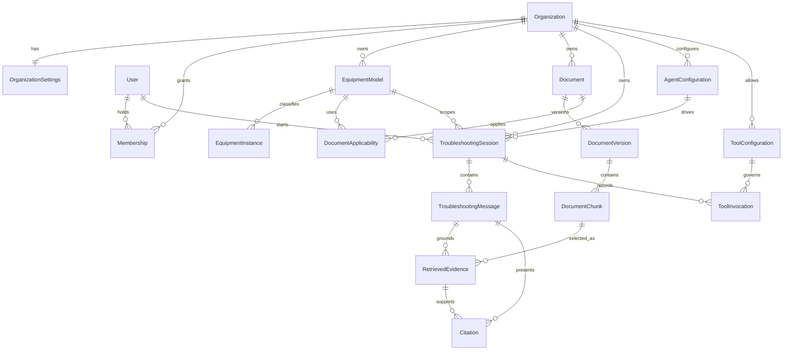

# File2FormAI Data Model

## 1. Modeling principles

- Use UUID primary keys so identifiers are not meaningful across tenants.
- Store timestamps as timezone-aware UTC values and retain actor/correlation metadata for audited changes.
- `User` is global identity data. `Organization` is the tenant root. `Membership` is the only path from a user to organization-specific roles.
- Every tenant-owned table includes a non-null `organization_id`, even when it could be derived through another relation. This makes tenant predicates explicit and supports database enforcement.
- Give tenant-owned tables a unique constraint on `(organization_id, id)`. Same-tenant relationships should use composite foreign keys such as `(organization_id, document_version_id)` wherever PostgreSQL/SQLAlchemy mapping remains practical.
- Repository reads and writes require `organization_id`. A bare primary-key lookup is not an allowed tenant repository operation.
- Preserve document versions, retrieved evidence, citations, and tool invocation history as audit records. Lifecycle policy may hide or tombstone them but must not silently break provenance.
- JSON fields are reserved for genuinely variable, schema-validated configuration or provider metadata. Stable searchable concepts belong in typed columns or related tables.
- Secrets never belong in configuration JSON. Persist only a reference to an external secret.

## 2. Relationship overview

`DocumentApplicability` is an association table rather than a first-class product concept. Additional operational tables—such as ingestion attempts, an outbox, workflow checkpoints, or audit events—will be designed when their implementation decisions are made.

## 3. Entity definitions

The fields below establish semantic requirements, not a frozen migration. Exact SQL types, enum implementation, indexes, and nullability should be finalized in migrations with representative data and query plans.

### Organization

Tenant root and security boundary.

- UUID `id`
- `name`
- `slug` — globally unique, stable URL/display selector; not authorization proof
- timezone-aware `created_at` and `updated_at`

Organization lifecycle status and suspension behavior remain deferred. There is no unrestricted organization creation, listing, or deletion API in the initial implementation.

### OrganizationSettings

One-to-one, organization-owned configuration.

- `organization_id` — primary and foreign key
- `display_name`
- nullable `logo_url`
- `primary_color` and nullable `secondary_color` as validated six-digit hex colors
- `technician_label`
- `custom_settings` JSONB for validated, variable organization configuration

Settings cannot override authorization, tenant isolation, evidence preservation, citation validation, or audit requirements.

### User

Global representation of a human identity, not a tenant owner.

- UUID `id`
- globally unique `email`
- `display_name`
- timezone-aware `created_at`

Email identifies deterministic development fixtures but is not authorization proof. Issuer/subject claims, identity lifecycle status, and profile synchronization will be added with production authentication.

### Membership

Joins a user to an organization and stores organization-specific authorization.

- `organization_id`, `user_id` as a composite primary key
- one constrained initial `role`: `org_admin`, `supervisor`, or `technician`
- unique `(organization_id, user_id)`

A user can hold multiple memberships. Roles from one membership never carry into another organization context.

### EquipmentModel

An organization-defined equipment type or model.

- UUID `id` and required `organization_id`
- `manufacturer`, `model_name`, and `description`
- `metadata` JSONB, mapped as `metadata_` in Python to avoid SQLAlchemy's reserved `metadata` attribute
- timezone-aware `created_at` and `updated_at`
- unique `(organization_id, id)` for composite tenant foreign keys

Core behavior refers to “equipment model”; tenant terminology may render it differently.

### EquipmentInstance

A specific asset belonging to an organization.

- UUID `id` and required `organization_id`
- `equipment_model_id` with a same-organization foreign key
- nullable `serial_number`
- `display_name`
- `metadata` JSONB, mapped as `metadata_` in Python
- timezone-aware `created_at` and `updated_at`
- unique `(organization_id, id)`

An instance is optional for a troubleshooting session; a model is required so retrieval has a defined document scope.

The database enforces `(organization_id, equipment_model_id)` against the model's `(organization_id, id)`, so an instance cannot reference another tenant's model. The initial API returns HTTP 409 when deleting a model that still has instances. The database foreign key also uses `RESTRICT`; callers must delete or reassign instances first.

### Document

Stable logical identity for an organization-owned publication across versions.

- `id`, `organization_id`
- title, document type, organization-local reference number
- lifecycle/visibility status
- owner/uploader audit metadata
- unique constraints scoped to the organization where the business identifier is reliable

A document can apply to several equipment models through `DocumentApplicability`. Applicability is always same-organization.

### DocumentVersion

Immutable source version of a document.

- `id`, `organization_id`, `document_id`
- monotonically increasing organization/document-local `version_number`
- source filename, media type, byte size, checksum
- opaque organization-namespaced object key
- parser adapter/version metadata
- ingestion status and failure category/safe message
- source publication/revision metadata when known
- creator and audit timestamps
- unique `(organization_id, document_id, version_number)`

New bytes require a new version. A ready version is never mutated in place. Which version is active for retrieval is explicit metadata, not “latest row wins.”

### DocumentChunk

Retrievable derivative of one immutable document version.

- `id`, `organization_id`, `document_version_id`
- stable chunk ordinal within the version
- normalized text
- page start/end and structured locator data (for example page coordinates or section labels)
- source character/token offsets when available
- full-text search vector
- embedding plus embedding provider/model/dimension metadata
- chunking algorithm/version metadata
- checksum and audit timestamps
- unique `(organization_id, document_version_id, chunk_ordinal)`

Chunks from pending, failed, superseded, or unauthorized versions must be excluded by the retrieval query, not filtered after ranking.

### TroubleshootingSession

Organization-scoped interaction around a selected equipment context.

- `id`, `organization_id`
- initiating `user_id` and membership/actor metadata
- required `equipment_model_id`; optional same-organization `equipment_instance_id`
- `agent_configuration_id` plus its immutable revision/version
- lifecycle status, title/summary, and audit timestamps
- optional workflow/checkpoint reference only after durability is designed

The service verifies the model, instance, agent configuration, and user membership in the same organization before creating or resuming a session.

### TroubleshootingMessage

Ordered user, assistant, system-visible, clarification, or tool-result content in a session.

- `id`, `organization_id`, `session_id`
- role/type and monotonically increasing session sequence
- content or structured content envelope
- author/provider metadata
- generation status, model usage, and safe error metadata
- created timestamp
- unique `(organization_id, session_id, sequence)`

Raw provider payload retention should be minimized and governed by a separate privacy/retention decision.

### RetrievedEvidence

Immutable record of evidence selected for a particular assistant response or retrieval attempt.

- `id`, `organization_id`
- `session_id` and response `message_id`
- `document_chunk_id` and exact `document_version_id`
- retrieval/query-run identifier
- lexical rank/score, vector rank/score, fused rank/score, and selection reason as applicable
- query text hash or safe query provenance
- text and locator snapshot used for generation
- embedding/retrieval configuration identifiers
- created timestamp

The snapshot preserves what the model actually saw even if derivative chunks are later reprocessed. Full sensitive query text retention is policy-controlled.

### Citation

Presentation-level link from an assistant message to evidence.

- `id`, `organization_id`
- assistant `message_id`
- `retrieved_evidence_id`
- citation ordinal/label
- quoted excerpt within policy limits
- rendered document title/version/page locator snapshot
- character offsets into the assistant message when needed by the UI
- validation status and created timestamp

A citation cannot point directly to an arbitrary chunk supplied by the model. It must resolve through `RetrievedEvidence` for that response and organization.

### AgentConfiguration

Organization-owned, versioned configuration for an approved troubleshooting agent.

- `id`, `organization_id`
- name, status, and revision
- workflow identifier/version
- version-controlled prompt identifier/version
- LLM and embedding adapter identifiers plus bounded non-secret settings
- retrieval policy parameters
- enabled tool-configuration references or policy links
- creator/approver and audit timestamps
- unique `(organization_id, name, revision)`

Published revisions used by a session are immutable. Reusable defaults may live in code/configuration templates; persisted tenant configuration remains organization-owned.

### ToolConfiguration

Organization allowlist and policy for one external tool capability or MCP server/tool pattern.

- `id`, `organization_id`
- stable server and tool identifiers
- enabled status
- allowed roles, workflows, and equipment scope
- argument/output schema or approved schema fingerprint
- approval requirement, timeout, rate limit, and output-size policy
- secret reference, never secret value
- configuration revision and audit timestamps

Discovery from an MCP server does not itself authorize use. The persisted allowlist and current policy do.

### ToolInvocation

Append-oriented audit of requested and attempted external actions.

- `id`, `organization_id`
- `tool_configuration_id`, configuration revision, and resolved tool identifier
- `session_id`; requesting/response message IDs when applicable
- requesting user/membership and approving actor when required
- correlation/idempotency key
- sanitized argument summary or hash
- status: requested, denied, approved, running, succeeded, failed, timed out, or cancelled
- start/end times, safe result summary/reference, and error category
- provider/server request identifiers and audit timestamps

Denied and failed attempts remain auditable. Result storage must be redacted and size-limited; large approved artifacts belong in tenant-scoped object storage.

## 4. Ownership and authorization matrix

| Entity | Ownership | Required access checks |
| --- | --- | --- |
| Organization | tenant root | platform/admin lifecycle policy |
| OrganizationSettings | organization | membership role plus schema/policy validation |
| User | global | self or authorized identity administration |
| Membership | organization + user | organization role administration; no cross-org role reuse |
| EquipmentModel / Instance | organization | active membership, role, same-org relationships |
| Document / Version / Chunk | organization | role, visibility, equipment applicability, version readiness |
| Session / Message | organization | membership, session access policy, same-org equipment/config |
| Evidence / Citation | organization through response | same session/message and exact authorized document version |
| AgentConfiguration | organization | configuration role; published revision for execution |
| ToolConfiguration / Invocation | organization | allowlist, current role/scope, approval policy, audit access |

Authorization failures should not reveal whether an identifier exists in another organization. Return the same not-found/forbidden policy chosen for unknown and cross-tenant resources, and log the distinction only in protected audit telemetry.

## 5. Storage and retrieval constraints

### Relational enforcement

- Index `organization_id` first in common tenant query paths.
- Use composite foreign keys to reject cross-organization relationships at write time.
- Include organization in uniqueness constraints unless a field is intentionally global.
- Constrain state transitions in services and, where stable, with database checks.
- Consider PostgreSQL row-level security as defense in depth after connection pooling, migrations, worker behavior, and operational escape hatches are designed.

### Search indexes

- PostgreSQL full-text search indexes normalized chunk text using an explicitly recorded language/configuration.
- pgvector stores embeddings with provider/model/dimension metadata so incompatible vectors cannot be mixed.
- Lexical and vector branches apply identical authorization/applicability filters before their respective limits.
- The vector index type and parameters are deferred until corpus size, update rate, latency, recall, and pgvector behavior are measured.

### Object and cache keys

An object key follows an opaque shape such as `organizations/{organization_id}/documents/{document_id}/versions/{version_id}/source`; user filenames remain metadata, not path components. Redis and frontend keys also begin with organization scope. Keys do not replace authorization checks.

## 6. Lifecycle notes

- Removing document applicability prevents new retrieval but does not rewrite historical evidence.
- Superseding a document version changes the explicit active version; historical citations continue to resolve subject to retention policy.
- Disabling a membership ends new access immediately; existing jobs and streams re-check authorization/status at defined boundaries.
- Suspending a tool configuration blocks new invocations while preserving its invocation history.
- Organization deletion is a governed retention/export operation, not an unreviewed cascade.

## 7. Unresolved data decisions

- whether memberships later support multiple simultaneous roles, invitation state, suspension, and audit metadata;
- soft deletion, retention periods, legal holds, data export, and cryptographic erasure;
- row-level security policies and how tenant context is safely set per transaction;
- ingestion-attempt, job, outbox, audit-event, and workflow-checkpoint schemas;
- exact document applicability rules for model families, serial ranges, regions, and revision dates;
- storage of rich locators for tables, diagrams, bounding boxes, and non-PDF sources;
- embedding migration strategy when model or vector dimension changes;
- privacy treatment of message bodies, queries, raw provider payloads, and evidence snapshots;
- tool argument/result redaction and large artifact retention; and
- schema for usage metering, quotas, billing, and per-organization rate limits.
